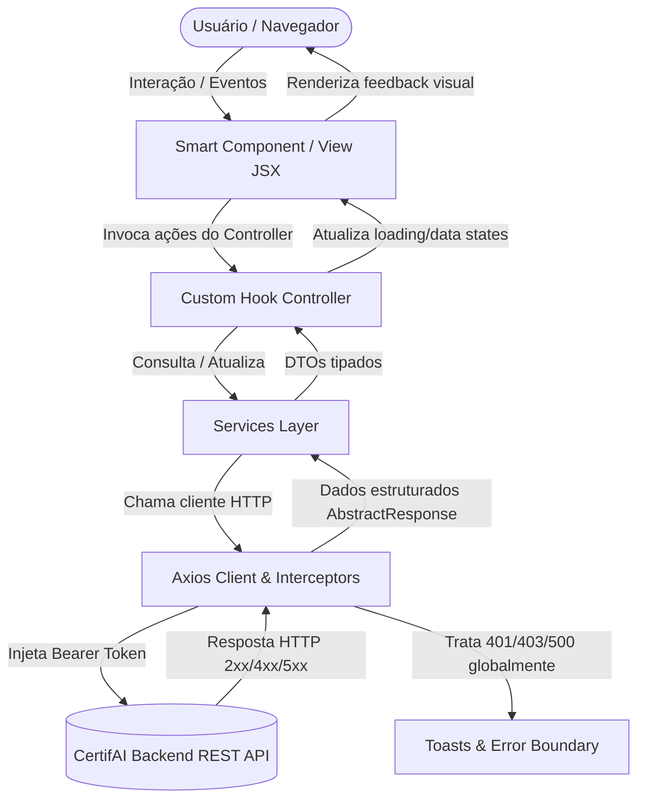
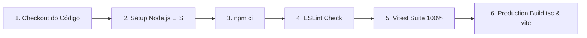

# CertifAI Frontend

[](https://github.com/mayeufraferreira/certifai-front/actions/workflows/ci.yml)
[](https://react.dev/)
[](https://www.typescriptlang.org/)
[](https://vitejs.dev/)
[](https://www.docker.com/)
[](https://nginx.org/)
[](https://vitest.dev/)
[](https://eslint.org/)

Plataforma web moderna, responsiva e acessível do ecossistema **CertifAI**, desenvolvida para gerenciar jornadas completas de preparação, simulados interativos, cronogramas de estudo e acompanhamento de desempenho para certificações profissionais de tecnologia (AWS, GCP, Azure, Kubernetes, entre outras).

---

## 📋 Visão Geral e Experiência do Usuário (UX)

O **CertifAI Frontend** atua como a interface central do usuário na plataforma CertifAI, oferecendo uma experiência de Single Page Application (SPA) fluida, reativa e segura, totalmente integrada aos serviços REST do `certifai-backend`.

### Principais Fluxos de Tela e Funcionalidades

1. **Autenticação & Controle de Acesso:**
   - Fluxo completo de autenticação com credenciais (JWT) ou Single Sign-On (Google OAuth2).
   - Confirmação de e-mail e validação de token de redefinição de senha (`/auth/verify`, `/forgot-password`, `/reset-password`).
   - Controle de sessões com expiração automática e redirecionamento seguro sem perdas de estado.
2. **Dashboard & Indicadores de Performance (`/dashboard`, `/performance`):**
   - Visão consolidada do progresso do usuário em exames e simulados concluídos.
   - Gráficos analíticos de taxa de acerto por área de conhecimento utilizando `Chart.js` e `react-chartjs-2`.
3. **Gestão de Certificações & Questões (`/certifications`, `/questions`):**
   - Catálogo de exames com filtros por dificuldade (Iniciante, Intermediário, Avançado) e busca textual.
   - Banco de questões categorizadas por tópico, permitindo cadastro de alternativas e justificativas.
4. **Simulador de Provas Interativo (`/tests`, `/tests/simulation/:provaId`):**
   - Montagem de simulados personalizados por certificação com temporizador configurável.
   - Ambiente focado para execução da prova, navegação entre questões, salvamento de respostas e cálculo de nota em tempo real.
5. **Planejamento & Checklists (`/calendar`, `/checklist`):**
   - Calendário visual interativo com agendamento de marcos de estudo e datas oficiais de exames.
   - Checklists operacionais com progresso percentual por certificação.
6. **Administração de Usuários (`/management`):**
   - Painel exclusivo para usuários com perfil `ADMIN`, permitindo auditoria, edição de perfis e desativação de contas.

---

## 🏛️ Arquitetura Frontend e Decisões Técnicas

O projeto adota uma arquitetura modular inspirada no padrão **Model-View-Controller (MVC) adaptado para React**, promovendo uma separação estrita de responsabilidades:

```
src/
├── assets/                 # Recursos estáticos (imagens, logotipos, fontes)
├── config/                 # Configurações de ambiente e constantes globais
│   └── environment.ts      # Centralização tipada de variáveis de ambiente (VITE_API_URL)
├── components/             # Componentes reutilizáveis
│   └── common/             # Componentes de apresentação puros (Dumb components)
│       ├── EmptyState/     # Feedback visual para coleções sem dados
│       ├── ErrorBoundary/  # Captura global de exceções de renderização
│       └── LoadingSpinner/ # Indicadores de carregamento com acessibilidade (a11y)
├── contexts/               # Provedores de contexto globais
│   └── authContext.tsx     # Gerenciamento de sessão, estado de autenticação e perfil
├── interfaces/             # Contratos de dados e DTOs fortemente tipados em TypeScript
├── pages/                  # Containers inteligentes / Views (Smart components)
│   ├── [nome-da-pagina]/
│   │   ├── index.tsx              # View: HTML semântico, acessibilidade e renderização visual
│   │   ├── indexController.tsx    # Controller: Custom hook contendo regras de negócio e chamadas a serviços
│   │   ├── indexModel.tsx         # Model: Interfaces locais, estados iniciais e constantes de tela
│   │   └── styles.css             # Estilização com escopo e design responsivo
├── routes/                 # Definição centralizada de rotas e proteção de acesso
├── services/               # Camada de abstração HTTP isolada (API Services)
│   ├── authService.ts
│   ├── calendarService.ts
│   ├── certificationService.ts
│   ├── checklistService.ts
│   ├── questionService.ts
│   ├── testService.ts
│   ├── userService.ts
│   └── index.ts
├── test/                   # Configurações e mocks globais de teste (Vitest + Testing Library)
├── api.tsx                 # Instância configurada do Axios com interceptadores globais
└── apiSemHeader.tsx        # Cliente Axios para rotas públicas e bootstrap de autenticação
```

### Decisões Arquiteturais Chave

1. **Separação View vs. Controller (Custom Hook):**
   - Os templates (`index.tsx`) concentram-se estritamente na renderização de tags semânticas e acessibilidade.
   - Toda a orquestração de formulários, chamadas assíncronas e manipulação de estado reside em hooks especializados (`use[Page]Controller`), permitindo testes unitários isolados da lógica sem acoplamento à árvore DOM.
2. **Camada de Serviços Dedicada (`src/services/`):**
   - Nenhuma chamada HTTP (`fetch` ou `axios`) é feita solta diretamente nos componentes. Todas as rotas do backend possuem métodos tipados com retorno baseado no envelope padrão `AbstractResponse<T>`.
3. **Resiliência e Interceptadores HTTP Globais:**
   - **Request Interceptor:** Injeta automaticamente o token JWT (`Authorization: Bearer <token>`) a partir do armazenamento local em todas as requisições autenticadas.
   - **Response Interceptor:** Intercepta globalmente respostas HTTP com status de erro:
     - `401 Unauthorized`: Limpa o token e força o redirecionamento para `/login`, exibindo alerta ao usuário sem loops de refresh.
     - `403 Forbidden`: Alerta visual de falta de permissão para a operação.
     - `404 Not Found`: Tratamento de rotas e recursos ausentes.
     - `500/502/503/504`: Feedback amigável para falhas transitórias do servidor.
     - **Falhas de Conexão/Offline:** Detecção de rede indisponível com mensagem clara para o usuário.
4. **Estados de Carregamento (Loading), Erro e Empty States:**
   - Operações assíncronas contam com gerenciamento de estado explícito (`isLoading`, `error`), exibindo componentes dedicados (`<LoadingSpinner />`, `<EmptyState />`) e botões com estado desabilitado durante submissões.
5. **Acessibilidade (a11y) e HTML Semântico:**
   - Uso de tags semânticas (`<main>`, `<section>`, `<header>`, `<nav>`, `<button type="...">`), atributos `role`, `aria-label`, `aria-live` em estados dinâmicos e suporte a navegação por teclado.

### Fluxo de Dados e Comunicação



---

## 🛠️ Stack Tecnológica

| Componente | Tecnologia | Versão | Propósito |
| :--- | :--- | :--- | :--- |
| **Framework Core** | React | `19.1.0` | Biblioteca reativa base para interfaces de usuário |
| **DOM Renderer** | React DOM | `19.1.0` | Renderização no navegador |
| **Linguagem** | TypeScript | `~5.8.3` | Tipagem estática rigorosa e prevenção de bugs |
| **Empacotador / Bundler** | Vite | `^6.4.6` | Build ultrarrápido, HMR e otimização de assets |
| **Roteamento** | React Router DOM | `^7.6.3` | Gerenciamento de rotas SPA cliente |
| **Cliente HTTP** | Axios | `^1.10.0` | Comunicação REST com interceptors e timeout |
| **Visualização de Dados** | Chart.js & React-Chartjs-2 | `^4.5.0` / `^5.3.0` | Dashboards analíticos de desempenho |
| **Ícones & UI** | Lucide React / React Icons | `^0.525.0` / `^5.5.0` | Ícones modernos e acessíveis |
| **Notificações** | React Toastify | `^11.0.5` | Feedback de sucesso/erro via toasts flutuantes |
| **Framework de Testes** | Vitest | `^5.1.0` | Runner de testes unitários nativo para Vite |
| **Ambiente de Testes DOM** | Testing Library & jsdom | `^16.2.0` / `^26.0.0` | Testes de componentes centrados no usuário |
| **Linter & Padronização** | ESLint & typescript-eslint | `^9.25.0` / `^8.30.1` | Análise estática de código e governança |
| **Servidor Web Produção** | Nginx Alpine | `stable-alpine` | Proxy reverso, gzip, segurança e roteamento SPA |
| **Conteinerização** | Docker & Compose | Multi-Stage | Empacotamento reproduzível de desenvolvimento/produção |

---

## 🚀 Como Executar Localmente (Quickstart)

### Pré-requisitos
- **Node.js** `>= 20.x` (recomendado LTS 22.x) e **npm** `>= 10.x`
- **Docker** e **Docker Compose** (caso opte pela execução em containers)
- Conexão de rede ativa para acessar o `certifai-backend` (hospedado ou local)

---

### Opção 1: Execução via Docker (Recomendada para Produção / Avaliação)

A imagem de produção utiliza **multi-stage build** com `node:lts-alpine` para gerar o bundle minificado e `nginx:stable-alpine` para servir a aplicação com compressão gzip e roteamento SPA:

```bash
# 1. Clone o repositório
git clone https://github.com/mayeufraferreira/certifai-front.git
cd certifai-front

# 2. Crie seu arquivo de ambiente local (ou use os padrões)
cp .env.example .env

# 3. Suba o container com o Docker Compose
docker compose up --build
```

A aplicação estará disponível em:
👉 **[http://localhost](http://localhost)** (ou na porta configurada via variável `PORT`).

Para verificar a saúde do container:
```bash
curl -I http://localhost/health
# HTTP/1.1 200 OK
```

---

### Opção 2: Execução Nativa (Ambiente de Desenvolvimento)

```bash
# 1. Instale as dependências do projeto
npm ci

# 2. Configure as variáveis de ambiente
cp .env.example .env

# 3. Inicie o servidor de desenvolvimento Vite
npm run dev
```

A aplicação inicializará com Hot Module Replacement (HMR) em:
👉 **[http://localhost:5173](http://localhost:5173)**

---

## 🧪 Qualidade de Código, Linter e Testes Automatizados

O projeto conta com uma suíte de testes unitários e de integração de componentes com 100% de aprovação e execução automatizada via CI:

```bash
# Executar a suíte de testes unitários (Vitest em modo headless/CI)
npm test

# Executar os testes em modo watch interativo
npm run test:watch

# Executar a verificação de lint e tipagem estática (ESLint)
npm run lint

# Gerar o bundle de produção estático (TypeScript typecheck + Vite build)
npm run build
```

---

## 🔄 Pipeline de Integração Contínua (CI/CD)

O workflow do GitHub Actions (`.github/workflows/ci.yml`) é acionado automaticamente a cada `push` ou `pull_request` nas branches principais, executando os seguintes estágios:



---

## 📄 Licença

Este projeto é distribuído sob os termos da licença **MIT**. Consulte o arquivo [LICENSE](file:///home/mayara.eufrasio/Área%20de%20trabalho/Workspace/certifai-front/LICENSE) para maiores informações.
